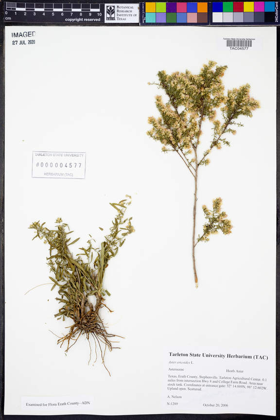
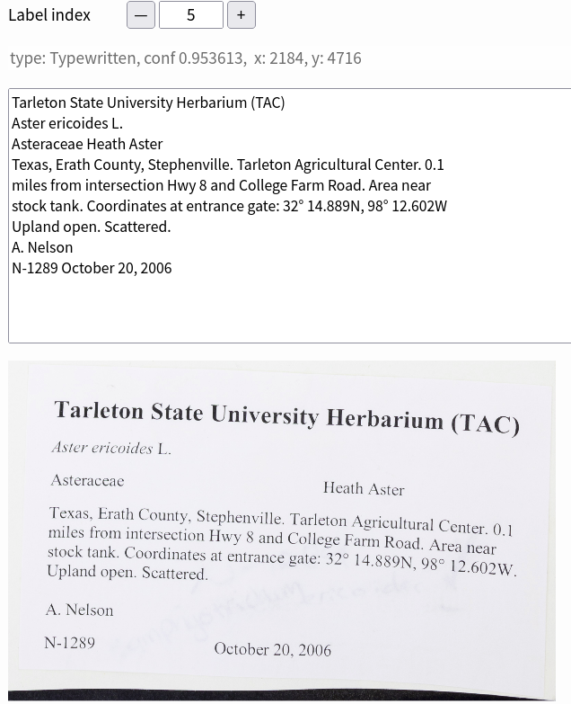
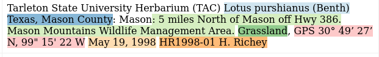
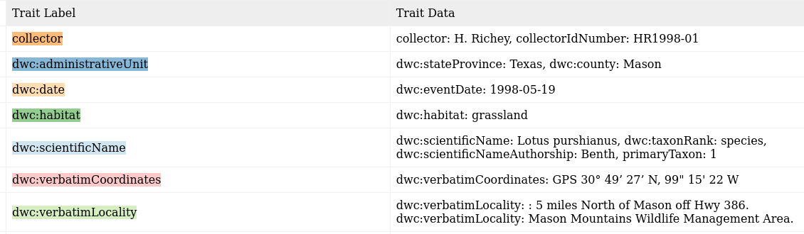
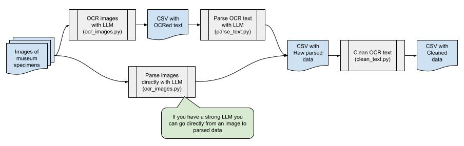

# Label Llama

Label Llama uses LLMs to digitize information from labels on images of museum specimens.
It OCRs the labels, extracts the text into named Darwin Core fields, cleans the field values,
and provides reports that compare the results.

The fields follow the [Darwin Core](https://dwc.tdwg.org/) standard, so the output is compatible with natural history data repositories.

## What it does

Given an image of a herbarium sheet (or an insect diode):

1. **OCR** — transcribe all of the label text.

2. **Parse** — extract the text into named Darwin Core fields.

3. **Clean** — refine the field values, and calculate field values from the other fields.

- **Parse images** Steps 1 and 2 can be combined into a single step.

### Example: from sheet to fields

An input image of a herbarium sheet:



The OCR step transcribes the label text:



The parse step maps spans of the text to Darwin Core fields:



The clean step produces the final fields and values:



## The pipeline

Each stage is a standalone script. The scripts exchange plain CSV files,
so you can run them in any order or mix and match model runs.

### The 3 primary scripts

1. **`ocr_images.py`** — Transcribe the labels on each specimen image with a vision
   model, writing one CSV row of per image. It appends to an existing OCR file, so
   you can keep adding images.
2. **`parse_text.py`** — Extract Darwin Core fields from OCRed text. The model is given
   the text and the fields named in the prompt file, and answers with field values.
3. **`clean_fields.py`** — Format and validate the extracted fields. It runs the Python
   class behind each field to tidy the value, throw out anything the model made up, and
   calculate the derived fields. No model is involved, so it is quick and repeatable.

### 2 extra scripts

1. **`parse_images.py`** — Extract Darwin Core fields straight from the image with a
   multimodal model, skipping the OCR step. One model call instead of two, which is
   only worth it if the model is big enough to read and parse text reliably.
2. **`ocr_msa.py`** — Although, recent models do reasonably well with most handwriting, there are some labels where the writing is sloppy or the text is obscured, etc. In these cases you can OCR same labels with different models. Then you combine the OCR output with a multiple sequence alignment into a single consensus sequence of text, which is often better than any single OCR. Quality vs time.

### There are 2 workflows



1. A 3-step workflow (works well locally)
   1. OCR text from images (ocr_images.py)
   2. Parse text (parse_text.py)
   3. Clean parsed data (clean_fields.py)
2. A 2-step workflow (if you have a larger model)
   1. You can parse data from an image directly (parse_images.py)
   2. Clean parsed text (clean_fields.py)

In the first workflow you can OCR the same images with several models and let
`ocr_msa.py` vote on what the labels really say, writing a consensus file of
`source` and `text` columns.

### Prompts and fields

A prompt markdown file holds the system message of a step plus, for the parse steps,
the list of fields that step extracts. Each field is a link to a Python class:

- `llama/llm_fields/` — _LLM fields_: the class holds the instructions sent to the LLM model and validates its answer.
- `llama/calc_fields/` — _calculated fields_: deterministic code that derives the value from other fields or an earlier version of itself.

There are three kinds of prompt file, one per kind of work:

| Kind              | Example prompts                  | Model input | Used by           |
| ----------------- | -------------------------------- | ----------- | ----------------- |
| OCR               | `ocr_v1.md`, `ocr_v2.md`         | image       | `ocr_images.py`   |
| Fields from text  | `herbarium_v2.md`, `diode_v2.md` | OCRed text  | `parse_text.py`   |
| Fields from image | `diode_one_v1.md`                | image       | `parse_images.py` |

- **OCR prompts** ask for nothing but a transcription of every label, tag and stamp,
  handwriting included, ignoring rulers, bar-codes and color bars. They declare no fields.
- **Field from text prompts** give the model OCRed text and ask for Darwin Core values,
  forbidding it from answering with anything not in the text. There is one per kind of
  specimen: herbarium sheets, and dragonflies pinned as diode specimens.
- **Field from image prompts** ask for the same fields from the image itself, so the
  model has to read the handwriting as well as interpret it.

`llama/reports/show_prompt.py` prints the full system message that a prompt file produces.

### Reports

The scripts in `llama/reports/` compare and visualize the output of model runs:

| Script                       | What it does                                                                      |
| ---------------------------- | --------------------------------------------------------------------------------- |
| `compare_ocr.py`             | Lines up the OCRed text of several runs in one HTML page.                         |
| `compare_parses.py`          | Shows the fields parsed by several runs side by side (stdout).                    |
| `compare_output_gold.py`     | Scores output against a gold standard, writing a CSV of the disagreements.        |
| `compare_output_gbif.py`     | Scores output against the GBIF record of the same specimen, writing an ODS sheet. |
| `compare_output_majority.py` | Picks the winning value of each field across several runs, writing an ODS sheet.  |
| `show_pipeline.py`           | One shareable HTML page per batch: the image, its OCRed text, its parsed fields.  |
| `show_prompt.py`             | Prints the system message that a prompt markdown file produces.                   |

### Data utilities

The scripts in `llama/data_utils/` are _ad hoc_ scripts to help build input data:

- `util_get_gbif_data.py` — narrows the large GBIF dump TSVs down to the
  images you downloaded.
- `util_image_download.py` — downloads specimen images from a GBIF
  multimedia TSV.
- `util_merge_files.py` — combines multiple files (`*.csv`, `*.tsv`, etc.)
  into a single file.

**They may not be useful to you as-is.**

## How to set up LabelLlama

You will need the python environment package manager called `uv` as well
as `git`.

### Step 1: Clone this repository

```bash
git clone https://github.com/rafelafrance/LabelLlama.git
cd LabelLlama
uv sync
```

### Step 2: (Optional) Set up a server to run local models

You don't have to run any models locally; hosted models work too.

#### llama.cpp

You can run `llama-server` directly from the
[llama.cpp](https://github.com/ggml-org/llama.cpp) project; the scripts
in `args/` show the options I use.

### Step 3: Extract information

Run the pipeline stages in order, or skip straight to the stage you
want. For example, for a batch of herbarium sheets:

```bash
uv run llama/ocr_images.py \
    --image-glob "data/my_sheets/images/*.jpg" \
    --ocr-file data/my_sheets/ocr.csv \
    --prompt-md prompts/ocr_v2.md \
    --model-id allenai/olmocr-2-7b

uv run llama/parse_text.py \
    --ocr-file data/my_sheets/ocr.csv \
    --parsed-file data/my_sheets/parsed.csv \
    --prompt-md prompts/herbarium_v2.md \
    --model-id "gpt-5-nano-2025-08-07" \
    --threads 20

uv run llama/clean_fields.py \
    --parsed-file data/my_sheets/parsed.csv \
    --clean-file data/my_sheets/clean.csv \
    --prompt-md prompts/herbarium_v2.md
```
